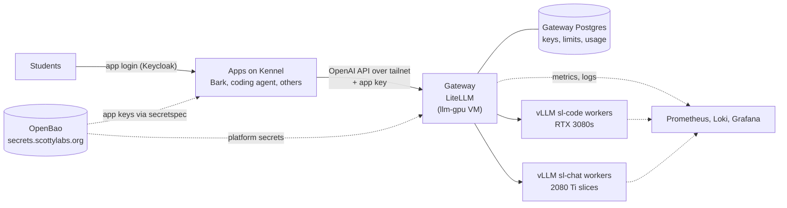

# RFC 0001: System Architecture

- **Status:** Draft
- **Author(s):** @jiyas
- **Created:** 2026-10-22
- **Updated:** 2026-10-22
- **Affects:** cmugpt-agent, cmugpt-surface, and future AI Team apps that call the platform

## Overview

This RFC records the architecture of the ScottyLabs AI Team's GPU infrastructure, which serves open-weight models from ScottyLabs GPUs to AI Team apps. It covers:

- the platform's components and what each owns;
- the contract between apps and the platform;
- trust boundaries and the two environments;
- the development environment.

RFCs 0002 (Models), 0003 (Inference and GPU layout), 0004 (Gateway, load balancer and app access), 0005 (Evaluation) and 0006 (Initial testing) will build on this document.

## Motivation

SLAI apps call outside model providers currently: for example, Bark calls OpenRouter. We're replacing that with open-source models running on a load-balanced, GPU infrastructure.

The platform has several moving parts (workers, a gateway, keys, monitoring), depends on systems run by OCC and devops, and will be called by other AI team apps.

## Goals

- Define each component's responsibility, and the data it owns.
- Document the app-to-platform contract and its trust boundaries.
- Set rules for changing that contract without breaking a running app.
- Separate what we build from what OCC and devops provide.
- Define a development environment built on ScottyLabs' existing tools.

## Non-Goals

- Model choice (RFC 0002), worker layout (RFC 0003), and gateway and load-balancer internals (RFC 0004).
- GPU machines, drivers, passthrough and vGPU: OCC handles these.
- Changing tools to outside of Kennel, the shared devenv module, OpenBao, Headscale or the observability stack.

## Detailed Design

### Components

| Component | Responsibility | RFC | Address |
|---|---|---|---|
| Gateway | Checks app keys, applies per-app and per-worker limits, routes to the least-busy worker, retries failures, records usage | 0004 | `http://llm-gpu:4000/v1` (tailnet) |
| `sl-code` workers | Serve the coding model, one copy on each of the three RTX 3080s | 0002, 0003 | `llm-gpu:8000`, `:8001`, `:8002` |
| `sl-chat` workers | Serve the light-app model on the two RTX 2080 Ti slices | 0002, 0003 | `llm-vgpu:8000`, `:8001` |
| Evals | Quality and speed tests that decide models and limits | 0005 | — |

**What we build vs. what's provided:**

| Provided by | What |
|---|---|
| OCC (the GPU cluster team) | GPU machines and Incus VMs with GPUs attached: host drivers, passthrough and vGPU, and each VM's configuration, including deploying our workers and gateway |
| Devops, through the infrastructure repo | Observability (Prometheus, Loki and Grafana) and shared services: the Headscale tailnet, OpenBao, Keycloak |
| Devops, through Kennel | Where the apps run and deploy, and how they get their secrets |
| Us | What runs on the VMs: model choice, worker settings, gateway configuration, app keys and evals |

OCC deploys the workers and gateway into the VMs from the configuration we provide. Apps keep deploying through Kennel from their own repos.

### Request flow

1. A student sends a message in an app. The app has already authenticated them through Keycloak.
2. The app applies its own per-student limits, then calls `POST /v1/chat/completions` on the gateway with:
   - its app key;
   - a model name (`sl-chat` or `sl-code`);
   - the student's pseudonymous ID in the `user` field;
   - thinking controls.
3. The gateway checks the key and the app's limits, then picks the least-busy worker serving that model name.
4. The worker runs the model and streams tokens back through the gateway, which records usage.
5. Agent-style apps repeat steps 2–4 for each tool round.

If the worker fails, the gateway retries once on another worker in the same pool. If the pool is full, the gateway returns a 429 with `Retry-After` right away.

### Contracts

**App to gateway (OpenAI-compatible HTTP).**
- **Endpoint:** `/v1/chat/completions`.
- **Model names:** `sl-chat` and `sl-code` only. These are stable even when the underlying model changes.
- **`user`:** the app's pseudonymous student ID. Bark already sends `oidc:<sha256("oidc:" + sub)>` from its Surface to its Agent; the Agent passes that value through unchanged.
- **Thinking:**
  - `sl-chat` requests turn thinking off.
  - `sl-code` requests set low or medium reasoning effort, or higher when the student uses "think harder".
  - Apps strip earlier reasoning from the history they resend.
- **Responses:**
  - streamed or whole;
  - tool calls in the standard OpenAI format;
  - a 429 with `Retry-After` when the pool is full.

RFC 0004 defines the full list of what apps must do.

**Gateway to worker (OpenAI-compatible HTTP).** Workers expose vLLM's OpenAI API, plus:
- `/health`, which the gateway uses to drop dead workers;
- `/metrics`, which Prometheus collects.

RFC 0003 defines worker settings.

### Trust boundaries and identity

- **Students never talk to the platform.** Only apps hold platform keys, and only over the tailnet. The gateway has no public address.
- **One key per app and environment,** delivered through OpenBao and secretspec. Keys never appear in browser-visible configuration or in git.
- **Identity is pseudonymous past the app.** The platform sees a hashed student ID, no name, email, Andrew ID, or other information.
- **Workers accept traffic only from the gateway.** They aren't meant to be called directly, even from the tailnet.

### Data ownership

| Data | Owner | Store |
|---|---|---|
| App keys and their limits | Gateway | Gateway Postgres, with a documented list of keys and owners |
| Usage metadata (app, hashed student ID, tokens, latency) | Gateway | Gateway Postgres, plus Prometheus |
| Prompt and response text | Not stored | Only logged temporarily to debug a specific problem |
| Model files | Workers | Local disk in each VM (`/var/lib/models`), pinned revisions |
| Eval questions and results | Evals team | Kept with the evals, questions anonymized |
| Chats, memory and per-student limits | Each app | The app's own database |

### Environments

| | Dev | Production |
|---|---|---|
| Hardware | A small vGPU slice carved from the 2080 Tis | 3× RTX 3080 for `sl-code`, and the rest of the 2080 Ti slices for `sl-chat` |
| Gateway and keys | Its own LiteLLM and test keys with low limits | Production LiteLLM and app keys |
| Used by | The team, plus apps' `staging`, `dev` and `preview` deploys | Apps' `main` (prod) deploys |

The same model names exist in both environments, so an app switches environment by changing its base URL and key, not its code. Kennel's secret profiles do that automatically: prod points at production; staging, dev and preview point at dev.

A change reaches production only after it has run in dev.

**Before the production hardware is ready,** the two 2080 Tis run as whole cards for the initial setup (RFC 0006). Once OCC slices them, part of one card becomes the dev environment and the rest serves `sl-chat`.

### Rules for changing the contract

1. **Additive first.** Add new optional request fields, model names or response fields before anything depends on them. Retire an old one only after every app has stopped using it.
2. **Deploy the callee first.**
   - The platform supports a new model name or field before any app sends it.
   - Within an app, the same rule applies between its own services. Bark's Agent rejects unknown request fields, so it must accept a new field before the Surface sends it.
3. **Model names are the contract.** Swapping the model behind `sl-chat` or `sl-code` needs evals (RFC 0005) but no app change. Adding or removing a model name needs an RFC.
4. **Write an RFC for any change to the app-to-gateway contract.**

### Development environment

We use ScottyLabs' existing development tools as often as possible; the exceptions are the inference engine, models and gateway, which are covered in RFCs 0002–0004.

- **Reviews:** changes go through pull requests on `git.cmu.dev` (Forgejo).
- **CI:** Forgejo Actions on the ScottyLabs runner, running configuration checks and a small eval set on pull requests.
- **Dev shell:** devenv with Kennel's shared module (`inputs.scottylabs.devenvModules.default`, `scottylabs.enable = true`). It provides `bao` and `secretspec`, sets `BAO_ADDR`, and exports resolved secrets into the shell. Postgres for the local gateway comes from `scottylabs.postgres`.
- **Secrets:** a committed `secretspec.toml` with Kennel's standard providers (`local`, `openbao`, `openbao-ci`) and profiles (`default`, `dev`, `prod`, `staging`, `preview`, `ci`). The `dev` profile resolves through OpenBao, so no one needs a `.env`.
- **Monitoring:** the ScottyLabs Prometheus, Loki and Grafana on infra-01.
- **Deploys:** handled by OCC. We hand configuration changes to OCC through their process.

**Local stack.** All model testing uses the real engine (vLLM) on the 2080 Tis; no other model server is used anywhere. `devenv up` runs a local gateway on a laptop, pointed at the dev environment's vLLM workers over the tailnet. That's for working on gateway configuration, keys and app integration.

| Process | Port |
|---|---|
| LiteLLM gateway | 4000 |
| Postgres (`scottylabs.postgres`) | 5432 |

## Alternatives Considered

- **Each app calls its own model servers directly.** It removes a hop, but every app would reimplement keys, limits, retries and load balancing, and five GPUs can't be split well between 4–5 apps.
- **Use the shared `litellm.scottylabs.org`.** It already provisions per-repo keys through governance. But every change to our routing would go through infra-01 and devops review, and our restarts would affect other projects' hosted-model traffic.
- **Run the platform on Kennel.** Kennel deploys apps well, but it runs everything on deploy-01, which has no GPUs, and it expects an `/api/health` endpoint LiteLLM doesn't serve.
- **Expose the gateway publicly.** That would let non-Kennel apps reach it, but it puts the GPUs on the internet. Every current app runs on Kennel, which is already on the tailnet.
- **Docker Compose for local development.** It's familiar to more people, but it duplicates what Kennel's devenv module provides and drifts from how ScottyLabs projects are built.

## Open Questions

- **Embeddings and moderation (deferred).** Bark also calls OpenAI for embeddings and moderation, not only OpenRouter for its chat model. For now Bark keeps OpenAI for both, and the platform serves only the chat models. Revisit after the chat models are live. Moderation can be switched at any time. Moving embeddings later means re-embedding Bark's stored memories.
- Which governance team owns the platform, and which Keycloak group grants access to its secrets?
- How do we hand configuration to OCC (a file they import, a pull request to them, or another process), and how quickly can a change go out?
- Should the gateway move to its own small VM, so a GPU VM failure doesn't take down every app?
