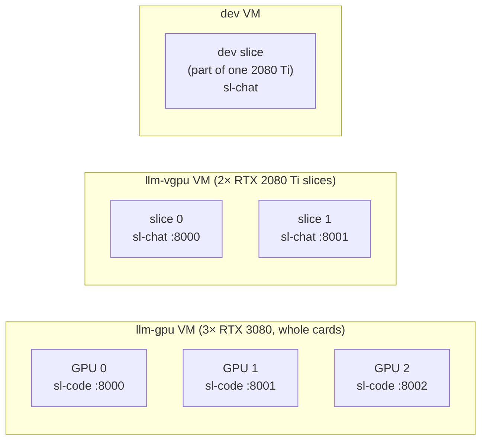

# RFC 0003: Inference Engine, Worker Runtime and GPU Layout

- **Status:** Draft
- **Author(s):** @jiyas
- **Created:** 2026-10-23
- **Updated:** 2026-10-23
- **Affects:** None outside the platform

## Overview

Every GPU runs one vLLM worker in a container. We hold the worker list (which model runs on which GPU, with what settings); OCC applies it to the VMs, which it configures and manages.

The layout:
- all three RTX 3080s sit in one VM and serve `sl-code`, one model copy per card;
- the two RTX 2080 Ti slices serve `sl-chat` for Bark and the other light apps (minus a small dev slice).

Model files live on each VM's local disk.

## Motivation

The models from RFC 0002 need something to run them, on GPUs that OCC provides as VMs (RFC 0001). We want a setup that:
- serves many simultaneous requests efficiently;
- is reproducible from git;
- allows scalability and lets us add a GPU with little changes;

## Goals

- One worker per GPU (or vGPU slice), each with an OpenAI-compatible API, `/health` and `/metrics` (the gateway-to-worker contract in RFC 0001).
- Everything about workers defined in one worker list. The same list feeds the gateway (RFC 0004) and monitoring.
- Adding a GPU means one entry in the worker list, which OCC then deploys.
- A restarted worker is serving again within a minute.

## Non-Goals

- Host drivers, passthrough, vGPU, kernel and licensing. OCC provides these.
- Creating and configuring the VMs, and deploying into them. OCC does this.
- Routing, keys and limits (RFC 0004).

## Detailed Design

### VMs and GPUs

- **The 3080 VM** needs the normal NVIDIA driver, and **the 2080 Ti and dev VMs** need NVIDIA's guest driver for vGPU. OCC installs both as part of the VM configuration.
- **Trade-off we accept:** with all three 3080s in one VM, restarting that VM takes down the whole coding pool at once. In return there's one system to manage.
- **Failed requests move to another card.** If a request fails or times out on one `sl-code` worker, the gateway retries it on another card (RFC 0004). That's why each card runs its own copy of the model.

### Why this split

| Pool | Cards | Why |
| --- | --- | --- |
| `sl-code` | 3× RTX 3080 | Far more people are expected to use the coding agent than the light apps, and it needs the fast cards and the most memory for long contexts |
| `sl-chat` | 2× RTX 2080 Ti slices | Bark and the other light apps send short requests to a ~9B model, which the slower cards handle well |
| Dev | A small slice of one 2080 Ti | The dev environment (RFC 0001): changes run here before production |

**If light-app traffic outgrows the slices** (for example a burst of new users when Bark is released), move one 3080 to `sl-chat` temporarily. It's one change to the worker list: GPU 2's entry goes from `sl-code` to `sl-chat`. The gateway picks it up automatically.

### Worker list

The file format is agreed with OCC. Whatever the format, the list carries the following.

**Per model:**

| Model name | Model | Context cap | vLLM arguments |
| --- | --- | --- | --- |
| `sl-code` | Qwen3.8-27B, 4-bit W4A16 build (AutoRound, GPTQ or AWQ), pinned revision | 32,768 | `--enable-auto-tool-choice --tool-call-parser <parser> --reasoning-parser <parser> --kv-cache-dtype fp8 --gpu-memory-utilization 0.95` |
| `sl-chat` | The chosen ~9B model (RFC 0002), 4-bit AWQ, pinned revision | 8,192 | `--enable-auto-tool-choice --tool-call-parser <parser> --reasoning-parser <parser> --dtype half --gpu-memory-utilization 0.90` (`--dtype half` because the 2080 Ti has no bf16 support) |

**Per worker:**

| VM | GPU | Model | Port | Max parallel requests |
| --- | --- | --- | --- | --- |
| `llm-gpu` | RTX 3080 #0 (by UUID) | `sl-code` | 8000 | 4 |
| `llm-gpu` | RTX 3080 #1 (by UUID) | `sl-code` | 8001 | 4 |
| `llm-gpu` | RTX 3080 #2 (by UUID) | `sl-code` | 8002 | 4 |
| `llm-vgpu` | 2080 Ti slice 0 | `sl-chat` | 8000 | 16 |
| `llm-vgpu` | 2080 Ti slice 1 | `sl-chat` | 8001 | 16 |
| dev | Dev slice (part of one 2080 Ti) | `sl-chat` | 8000 | Low, for testing |

The max-parallel values are starting points, to be set from benchmarks (RFC 0005).

For `sl-code`, memory is the tight part. After the ~15–16 GB model, a 20 GB 3080 has room for roughly 30–40k tokens of context in total. Storing the KV cache in 8-bit (`--kv-cache-dtype fp8`) and raising GPU memory use to 0.95 should bring that to about 80–100k tokens per card, or two to three long requests at once. Confirm both on a 3080 in benchmarks (RFC 0005).

### Workers

Each entry becomes one container, however OCC chooses to run it. Every worker needs:

- **Image:** `vllm/vllm-openai`, pinned to an exact version.
- **GPU:** pinned by UUID, so a reboot can't reorder cards.
- **Flags on every worker:** `--served-model-name <name>` and `--enable-prefix-caching`, plus the per-model arguments above, which also set GPU memory use.
- **Model files:** a volume at `/var/lib/models`.
- **Restart:** a failed worker restarts automatically.

### Model storage

- Each VM downloads its models once to local disk (`/var/lib/models`), at the pinned revision.
- Give the VMs enough RAM that model files stay cached in memory, so restarts are fast.
- Rebuilding a VM means downloading again. That's accepted for now.

### Health and metrics

- Each worker serves `/health`, which the gateway uses to drop dead workers.
- Each worker serves `/metrics`: queue depth, KV-cache use and time to first token. ScottyLabs' Prometheus collects them.

### How changes are applied

- We change the worker list or vLLM settings by pull request, and review it like code.
- OCC deploys the change to the VMs.
- Development uses the devenv shell described in RFC 0001.

## Alternatives Considered

- **SGLang instead of vLLM.** It's comparable or faster, with very good prompt caching, but it has a smaller community. vLLM is the safer default for a team new to this.
- **llama.cpp server.** It runs on anything, but has much lower throughput with many simultaneous users. It's kept as the fallback for the 2080 Ti slices if vLLM misbehaves under vGPU.
- **Ollama, or another local model server, as a laptop stand-in.** It would let people test without a GPU, but its 4-bit builds differ from production, so results wouldn't carry over. All testing uses vLLM instead: `sl-chat` on the 2080 Tis, `sl-code` on a 3080.
- **TensorRT-LLM.** It's the fastest on NVIDIA hardware, but needs complex builds for each card type. Overkill here.
- **A shared Ceph volume or our own S3 mirror for models.** Either avoids downloading again when a VM is rebuilt, at the cost of more setup. Revisit if rebuilds become frequent.
- **One VM per 3080.** It's more isolated, but means three systems to manage.
- **Keeping one 3080 for `sl-chat` at launch.** It would protect Bark against a burst of new users at release, but it takes a third of the coding capacity. It's kept as the fallback described in Why this split, rather than the default.
- **One copy of the coding model split across two cards.** It gives more room for long contexts, but if either card fails, coding is down, and there's no other card to retry on.

## Open Questions

- Does vLLM run correctly inside a 2080 Ti vGPU slice? If not, use llama.cpp server there.
- What slice sizes do we get on the 2080 Tis, and how much of one card goes to the dev slice?
- How many parallel `sl-chat` requests fit on a 2080 Ti slice? Set it from benchmarks.
- Are the 2080 Ti slices fast enough for Bark at its release? If not, use the one-3080 fallback.
- Which vLLM version should we pin for Qwen3.8-27B? Community setups run it on Ampere RTX 3090s with vLLM 0.26–0.28 and 4-bit W4A16 or AWQ builds. Confirm on a 3080, then pin that version. FP8 and NVFP4 weight builds won't work: the 3080 has no FP8 tensor cores, and NVFP4 needs newer GPUs. Storing the KV cache in FP8 is different (it's only storage), and is used above.
- `sl-code` benchmarks need a 3080. vLLM's fast 4-bit kernels need a 3080-generation card or newer, so Qwen3.8-27B may not run in vLLM on the 2080 Tis; there, only `sl-chat` can be tested in vLLM.
- How many `sl-code` requests fit per card in practice? Set the max-parallel value from benchmarks.
- How the containers run (Podman, Kubernetes or something else) is OCC's choice. Do they have one in mind?
