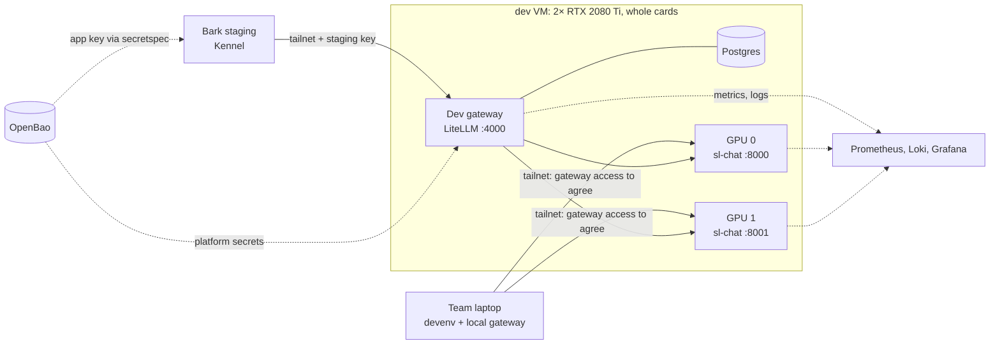

# RFC 0006: Initial Testing

- **Status:** Draft
- **Author(s):** @aaronz2
- **Created:** 2026-10-24
- **Updated:** 2026-10-24
- **Affects:** the platform repo, and `cmugpt-agent` (Bark's staging deploy)

## Overview

We set up the dev environment from RFC 0001 on the two RTX 2080 Tis we have now, as whole cards. Bark's staging deploy calls it, and we use it to run the `sl-chat` evals and test what happens when things fail. The coding model is tested separately on a borrowed 20 GB RTX 3080.

## Motivation

The platform has several parts we haven't run together yet: vLLM, the gateway, app keys, OpenBao and monitoring. We also haven't measured how the models from RFC 0002 run on our cards.

We need to find out:

- whether vLLM runs the `sl-chat` candidates on a 2080 Ti, and how many requests fit;
- whether `Qwen3.8-27B` is fast enough on a 3080, with room for context;
- whether the gateway handles full pools and failed workers as RFC 0001 describes;
- whether Bark can reach it from Kennel and get its key through OpenBao;
- whether the memory-modded cards stay stable under load.

RFC 0001 requires changes to run in dev before production. This gives us that environment while only the team is using it. RFC 0004 isn't written yet, so the gateway settings here are starting points for it.

## Goals

- A working path from Bark staging through the dev gateway to the `sl-chat` workers.
- Quality and speed results for each `sl-chat` candidate, using RFC 0005.
- Measured request limits for a whole 2080 Ti.
- Tests for overload, worker failure, gateway failure and recovery.
- Coding evals and per-card benchmarks on a 20 GB 3080.
- A checklist for moving from initial testing to production.

## Non-Goals

- Serving students. Only the team and Bark staging use this setup.
- Final capacity across three 3080s. One borrowed card gives per-card results.
- Setting up vGPU or configuring OCC's machines. OCC does this.
- Onboarding apps other than Bark.
- Changing decisions in RFCs 0001–0003. If testing finds a problem with one, we bring it back to that RFC.

## Detailed Design

### Test setup

- **Both cards in one VM.** We test candidates one at a time under `sl-chat`. For load and failover tests, both workers run the same pinned model, quantization, tokenizer and parsers. Candidate swaps are scheduled around staging use.
- **Configuration in the platform repo.** We supply the worker list, gateway settings, keys and monitoring. OCC configures the VM and deploys them, as in RFCs 0001 and 0003. We don't work in OCC's repo.
- **Gateway and Postgres on the dev VM.** A separate production gateway VM is still open in RFC 0001.
- **Whole cards first.** The 2080 Tis use the normal NVIDIA driver. Once OCC slices them, part of one becomes dev and the rest serves `sl-chat` (RFC 0001). We test the slices again when they exist.
- **Worker access.** RFC 0001 allows only gateways to call workers, including the local gateways on team laptops. We need to agree how those gateways get access. RFC 0005's direct-worker benchmarks also need an agreed exception. Worker ports stay closed to other tailnet clients; Prometheus has separate access for metrics.

### What we ask OCC and devops for

The sizes and durations below are proposed starting points.

| Ask | From | Starting point |
| --- | --- | --- |
| One VM with both 22 GB 2080 Tis passed through | OCC | Confirm GPU UUIDs, visible memory, driver, CPU allocation and handover date |
| RAM | OCC | 64 GB |
| Local disk at `/var/lib/models` | OCC | 250 GB |
| Tailnet access | Devops | Tagged VM key, access from Kennel staging and CI, agreed worker access |
| OpenBao policy | Devops | Dev platform paths and Bark's staging secretspec paths |
| Monitoring | Devops | Prometheus targets, Loki access, a Grafana folder and an alert channel |
| One whole 20 GB RTX 3080 | OCC | About two days for coding tests and reruns |

RFC 0002's weight estimates add up to about 47–56 GB for the three chat candidates and both coding builds. The disk ask leaves room for images and downloads. We check actual file sizes first, especially if the coding tasks need large container images. The RAM ask is for the running services and active chat models' file cache. We measure memory use and reload time rather than assuming 64 GB is enough.

**Borrowing or renting a card.** A stock 3080 has 10 or 12 GB, so we need to confirm the borrowed card has 20 GB. If none is available, we can ask the team to approve a rental, such as a 24 GB RTX 3090. Agree a cost cap and owner first, and check GPU access, drivers, storage and cleanup. Borrowed or rented machines only see coding tasks and synthetic load, never the Bark question set or production secrets (RFC 0005).

On a 24 GiB card, `--gpu-memory-utilization 0.833` gives vLLM roughly 20 GiB. To match RFC 0003's 20 GiB card at 0.95 utilization, the starting value is `(20 × 0.95) / 24 ≈ 0.792`. Use the actual reported memory and record the allocations. An explicit KV-cache byte setting can override this flag ([vLLM arguments](https://docs.vllm.ai/en/latest/configuration/engine_args/#cacheconfig)).

This only approximates the memory budget. A 3090 has more cores and bandwidth than the original 3080 ([NVIDIA specifications](https://www.nvidia.com/content/PDF/nvidia-ampere-ga-102-gpu-architecture-whitepaper-v2.pdf)), so we still need a 3080 run before rollout. Rental results don't give a guaranteed speed bound.

RFC 0003's Ampere-only Marlin claim also needs review. Current [vLLM documentation](https://docs.vllm.ai/en/latest/features/quantization/#supported-hardware) lists Turing support for some Marlin formats. We test the exact build and engine version on each card.

### Bark staging

`cmugpt-agent` currently uses one hardcoded OpenRouter client for chat, titles and memory extraction. The chat path also checks for `OPENROUTER_API_KEY`. Changing the base URL alone won't switch it.

The changes in `cmugpt-agent`:

- **Settings:** add `LLM_PLATFORM_BASE_URL` and `LLM_PLATFORM_API_KEY` to settings and secretspec. Both are required when using the platform. With neither set, the current provider path still works for production and the Luna baseline.
- **Client:** use the configured endpoint and key, and include both in the client cache key. Replace the OpenRouter-only key checks. Platform failures return errors rather than falling back to OpenRouter.
- **Model:** use `sl-chat` for chat, titles and extraction. The staging harness also asks for `sl-chat`, so an old provider model ID can't select another model. Turn thinking off using the pinned model's supported settings.
- **Identity:** pass the Surface's pseudonymous ID unchanged in the OpenAI `user` field on calls associated with that user. Embeddings and moderation stay on OpenAI (RFC 0001).
- **Errors:** show a busy message on 429 and honor `Retry-After`, with a bounded number of retries. A failed turn that has already streamed or run tools isn't restarted automatically.

**Deploy order:** deploy the gateway and key first, then set the two variables in Bark's staging OpenBao profile, then deploy the Agent changes to staging. Production keeps its current profile. Test the staging Agent through the harness. A browser test also needs a staging Surface pointing at it, with the same staging shared secret; coordinate that with the app owners.

**Rollback:** restore the previous staging profile and compatible Agent revision, redeploy, and run a smoke turn. Test this before the week of team use. Record the deployed revision and endpoint, without logging keys.

### What carries over

| Result | What it tells us | What we repeat in production |
| --- | --- | --- |
| Keys, networking and monitoring | The dev path works | Production profiles, access rules and targets |
| Failure tests | The tested gateway configuration works in dev | Tests with the production worker count and VM layout |
| `sl-chat` quality | The pinned build and app code pass | Evals if the build, precision, parsers or app code change |
| `sl-chat` speed and capacity | A whole-card baseline | Benchmarks on the actual slice, with other slices busy |
| `sl-code` quality | Early results if it loads on a 2080 Ti | Evals on the 3080 with its chosen precision and KV cache |
| `sl-code` speed and capacity | Per-card results from a matching 3080 | Limits on the actual production workers and full pool |

The 2080 Ti runs in fp16 (`--dtype half`, RFC 0003). Precision and kernel differences can change outputs, so early coding evals there are recorded separately. Whole-card chat results also don't set a slice's limits.

### Tests

Quality, speed and capacity follow RFC 0005. Its pass bars are still proposals. The wiring, recovery, soak and alert checks below add tests that RFC 0005 doesn't define yet; their timings and pass conditions are proposals too. The memory sweep and 8-request coding test come from Step 9 of the options doc.

For every run, record RFC 0005's result fields, plus the driver, GPU UUID and visible memory, app and gateway revisions, precision, parsers, timeouts and retry settings. Summaries go in the platform repo. Bark questions and raw outputs stay in the restricted eval store. Record skipped or unsupported tests and why they couldn't run.

### A. Bring-up

On every new VM or card:

- Save `nvidia-smi` output showing the expected cards, memory and driver. Check that the container sees them and loads the pinned model.
- Run the model under load for a proposed one hour, with no failed requests, GPU resets or worker crashes.
- Record idle and normal decode speed, p50 and p95, as the baseline for later runs.

Use RFC 0005's normal load. If Bark's traffic export isn't ready, record the chosen concurrency and repeat the test once normal load is known. These cover Step 2's handover checks.

### B. Wiring

- Bark staging gets its key through OpenBao and secretspec. Missing, invalid and revoked keys are rejected. A key can only request its allowed models.
- An ordinary tailnet client can't call a worker directly.
- Chat, streamed tool calls, titles and memory extraction all use the dev gateway. Tool calls use the standard OpenAI format. With thinking off, no reasoning text appears in the answer.
- The gateway records the pseudonymous `user`, tokens and latency. Send a synthetic text marker and check that prompt and response text are absent from worker/gateway logs, the database and exported logs. Content logging and debug callbacks are off before using Bark questions (RFC 0001).
- Requests below and at the context cap work. An over-cap request returns a clear client error within the request timeout. Count the system prompt, tools, history and requested output against the cap.
- The staging rollback works, and production's provider settings are unchanged.

### C. `sl-chat` evaluation

Every candidate from RFC 0002 runs RFC 0005's Bark suite alongside `GPT-5.6 Luna`, with thinking off. This includes the multi-turn questions, repeated subset and hand grading. Luna runs through the existing provider path, outside the platform.

Report RFC 0005's tool selection, arguments, valid output, answer correctness, safety, agreement with Luna, TTFT and Bark turn time. The fastest candidate that passes the agreed bars is proposed as `sl-chat`.

RFC 0002 still has the older agreement and validity goals. We need to agree its update to RFC 0005's bars before choosing the model. If no candidate passes, bring that result back to RFC 0002.

### D. Capacity and load

- Run each chat candidate at 1, 2, 4, 8, 16 and 32 simultaneous requests (RFC 0005). Use Bark-shaped prompt lengths and shared prefixes. Record cold and warm TTFT, decode speed and preemptions.
- Repeat through the gateway at RFC 0005's idle, normal and peak levels. Normal needs Bark's busiest-hour traffic export.
- With two identical workers, mix two app keys with different request, token and parallel-request limits. Each key's limits are enforced separately.
- When full, the gateway returns 429 with a usable `Retry-After` within one second. Gateway overhead stays below 100 ms at p95 (RFC 0005). Check headers with client retries off, then test Bark's retry behavior.
- Cancel a stream and check that its request slot is released within the configured cleanup timeout.

RFC 0005's max-parallel rule needs a decode-speed bar, but doesn't give one for `sl-chat`. Until that's resolved, report the highest concurrency meeting the warm TTFT bar with no preemptions as provisional.

This setup only has `sl-chat` at first. A `sl-code` request must be rejected rather than sent there. The full mixed-pool test from RFC 0005 waits until both pools exist, and must pass before production rollout.

### E. Failure

Both workers run the same build, with enough room on the surviving worker for the test load. Record worker IDs and attempt counts, without prompts. Turn off client retries when counting gateway attempts.

Before running, record request and stream-idle timeouts. We propose a dead-worker detection limit of one health-check interval plus the probe timeout.

| Action | Expected |
| --- | --- |
| Kill a worker before response headers, then after headers but before content | One retry on a different worker in the same pool, followed by success or an error within the timeout |
| Kill a worker after content has streamed | The Agent shows an error and doesn't emit a successful `done`. It doesn't join a new answer onto the partial one or replay tools |
| Keep one worker down | New requests move to the healthy worker within the detection limit, and stop reaching the dead worker |
| Restart the worker | It serves a model request within one minute (RFC 0003). Separately record when the gateway starts using it again |
| Fill both workers | 429 with `Retry-After` within one second, with no cross-pool fallback |
| Stop both workers or drop their network traffic | Requests fail within the timeout, and work again after recovery |
| Restart the gateway | Existing calls finish or fail within their timeout. New calls work after readiness returns, with the same keys |
| Stop and restore Postgres | Record cached and uncached key behavior, invalid/revoked keys, readiness and usage writes. Repeat after the auth-cache TTL and a gateway restart. Check key management and logging after recovery, including any lost usage |

An unavailable pool may return a different error from a healthy but full pool. A partial stream also can't change its HTTP status after headers are sent; the Agent has to show the failure.

**Gateway settings to test:**

- Pin LiteLLM. Start with `num_retries: 1` for worker failures and an error-specific policy that returns full-pool 429s promptly. Check that callers can't increase the allowed attempts.
- Use least-busy routing, per-worker `max_parallel_requests` and no cross-model fallback lists. Check the retry actually chooses another worker.
- Set `background_health_checks`, `health_check_interval` and `enable_health_check_routing`, with `allowed_fails` or `allowed_fails_policy` and `cooldown_time`. Check whether probes use vLLM's `/health` or make model requests, and resolve any difference from RFC 0001.
- Test both-workers-down: some LiteLLM [health-routing paths](https://docs.litellm.ai/docs/proxy/health_check_routing) try unhealthy workers when none remain.
- Check `Retry-After` on the actual capacity-error path. A missing header needs a fix through RFC 0004.
- Start with `allow_requests_on_db_unavailable` off. Cached keys may still work until expiry. Agree the acceptable outage behavior before release and put it in the runbook.

### F. Soak

We propose one hour at normal load, then low load overnight. Record the overnight concurrency and duration, and repeat the same baseline workload before and after.

- No failed requests, worker crashes, GPU resets or host OOMs.
- Host and GPU memory use settle after caches fill. Investigate continuing growth or a drop in speed before passing the run.
- GPU temperatures stay within limits agreed with OCC. Record available clocks, throttling and errors too.

Record process memory and file-cache use separately. Memory temperature is only collected if the card reports it. We don't assume a 2080 Ti exposes GDDR6 memory temperature through `nvidia-smi`, NVML or dcgm-exporter; unavailable sensors are marked unsupported. This adds to OCC's hardware checks.

### G. Observability

- Grafana shows worker queue depth, KV-cache use, preemptions and TTFT, plus requests, errors and latency per app. Check a test request against the scrapes and counters.
- Killing a worker sends an alert to the team's channel. Record the alert rule's evaluation and pending delays, allow time for delivery, and check both the alert and its resolved notification.

### H. `sl-code` on the borrowed 3080

- A pinned 4-bit build of `Qwen3.8-27B` loads in the pinned vLLM version. Record GPU memory and the selected kernels.
- Measure memory at 8k, 32k and 64k contexts, with the default and FP8 KV cache where supported. The 64k test temporarily raises the 32k service cap; restore it afterward. Record unsupported settings and OOMs. Don't use host offloading for the fit test.
- Run RFC 0005's concurrency steps: 1, 2, 3, 4 and 6. Find max-parallel at the 32k cap. Add 8 as an overload test for Step 9's 1/4/8 comparison, recording failures to fit.
- Record cold TTFT at 4k, 8k, 16k and 32k prompts, warm TTFT, time to first answer token and decode speed. Report p50/p95 at idle, normal and peak. Once max-parallel is known, rerun at the resulting normal load.
- Check prefix caching on the same worker. Repeat a prompt prefix and record changes in `vllm:prefix_cache_hits` and `vllm:prefix_cache_queries`, using the pinned version's metric names. Gateway response caching is off for this test.
- Run RFC 0005's 30 coding tasks three times each, plus the agreed public subset. Record pass rate, steps, tokens, context-cap hits and task time.
- Try the same tests for `Qwen3-Coder-30B-A3B` as far as one card allows. RFC 0002 expects two cards for context headroom. The full fallback test waits for two 3080s and an agreed layout in RFC 0003.

The result is a speed go/no-go against RFC 0005's bars and a per-card max-parallel value. Coding pass rate and cold TTFT don't have pass bars yet. We need to agree those before making the release decision. If the fallback is needed, its two-card layout also needs testing first.

The cold/warm TTFT difference feeds RFC 0004. If it's large, we should test keeping each coding task on the same worker.

### Exit checklist

We propose a week of team use through Bark staging after the last blocking fix. Record dates, request counts and failures.

Before production rollout:

- [ ] OCC can deploy and redeploy the configuration from the platform repo without manual VM edits.
- [ ] A, B and G pass, including access rules, content-log checks, rollback, dashboards and alerts.
- [ ] The staging week is complete, with no unexplained platform failures. Fixes have been retested.
- [ ] Every chat candidate has C results, and RFC 0002 records the chosen model. Questions and raw outputs are in the restricted store.
- [ ] D passes, and per-worker limits are set after resolving RFC 0005's missing chat decode-speed bar.
- [ ] E passes with the agreed timings and Postgres behavior. Contract failures are fixed or reviewed in the owning RFC.
- [ ] F passes, with its load, duration and memory/health results recorded.
- [ ] H has results from a 20 GB 3080 and the coding tasks. The open quality and cold-TTFT criteria are agreed through RFC 0005. If needed, the two-card fallback has been tested.
- [ ] A, B, D, E, F and G have been repeated on production hardware. The actual 2080 Ti slices are tested with other slices busy, and the 3080 worker limits are checked. C is repeated if its build or app code changed.
- [ ] RFC 0005's full mixed-pool test passes with both models available, including no requests crossing pools.
- [ ] Results, runbooks and owners are in the platform repo. RFC 0004 records the tested gateway behavior, and needed changes to RFCs 0002 and 0003 have been reviewed.

The setup stays as dev after testing. Once OCC moves it to a slice, we measure its limits again. Later changes still run in dev before production (RFC 0001); how we do that for coding changes that need a 3080 is still open.

## Alternatives Considered

- **Go straight to production.** It saves a step, but problems show up with students using the platform. The 3080 VM's layout is also fixed until OCC rebuilds it (RFC 0003).
- **A throwaway test VM.** It means setting up the environment twice. We keep this one as dev and schedule candidate swaps around team use.
- **One card only.** It's easier to get, but can't test moving requests off a failed worker.
- **Rent GPUs for everything.** It doesn't test our OCC, OpenBao or tailnet path, and costs money. We keep it as a fallback for early coding tests only.
- **Laptops with Ollama.** Rejected in RFCs 0001 and 0003. Laptops run the gateway and harness against real vLLM workers.

## Open Questions

- When can OCC hand over the two whole 2080 Tis, and with which driver, CPU, RAM and disk? What GPU health limits should we use?
- Can OCC lend a 20 GB 3080 for about two days? If not, who pays for a rental, and when can we confirm its results on a matching 3080?
- Does the pinned build work on Turing? RFC 0003's Marlin support claim needs updating after checking the chosen version.
- How do we hand configuration to OCC? How do laptop gateways and worker benchmarks get access under RFC 0001's rules?
- Can Kennel staging and CI reach the dev gateway? Who sets up the staging Surface for browser tests?
- Which LiteLLM version and settings pass E? What Postgres-outage behavior do we accept in RFC 0004?
- Which pass bars do we agree in RFC 0005, including chat decode speed, coding quality and cold TTFT? Do the extra operational checks belong there too? RFC 0002's older Bark goals need to match.
- If we use the coding fallback, how does its two-card setup fit RFC 0003? How do later coding changes run in dev once dev only has a small chat slice?
- Who owns the Bark export, restricted store, coding tasks and public subset? What is the platform repo called, and who owns each phase?

## Implementation Phases

1. **Prepare** (`cmugpt-agent`, platform repo, restricted eval store). Build RFC 0005's question set, Luna baseline, coding tasks and harness changes. Write gateway and load-test configs. Send the asks to OCC and devops. This can start before the GPUs arrive.
2. **Bring-up** (platform repo; OCC deploys). Supply the worker configuration and pinned chat build. Run A.
3. **Wiring** (platform repo, `cmugpt-agent`). Deploy the gateway, Postgres, keys and monitoring, then Bark's staging changes. Run B and G. Coordinate the staging Surface with its owners.
4. **Evaluate and size** (platform repo, `cmugpt-agent`, restricted eval store). Run C and D. Agree the missing capacity criterion and set limits.
5. **Failure and soak** (platform repo, `cmugpt-agent` for error handling). Run E and F, fix failures and retest.
6. **Coding tests** (platform repo, this RFC repo). Run H once a card is available, alongside phases 3–5 where possible. Test the two-card fallback if needed.
7. **Write-up** (platform repo, this RFC repo). Record results and runbooks, review changes through RFCs 0002–0005, and finish the production checks before switching any app's production deploy.
